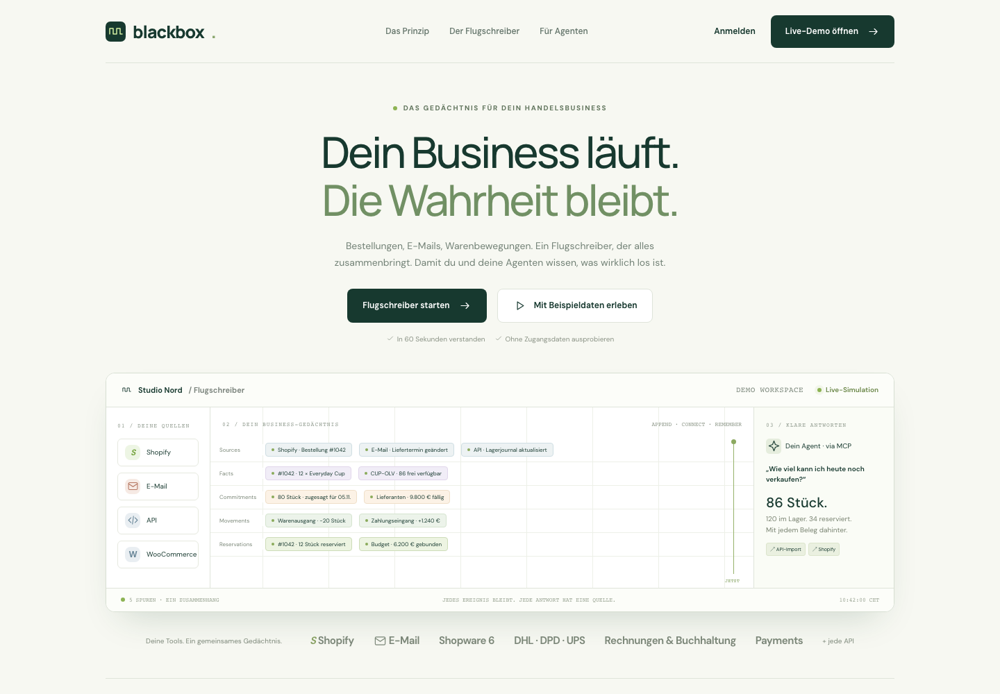
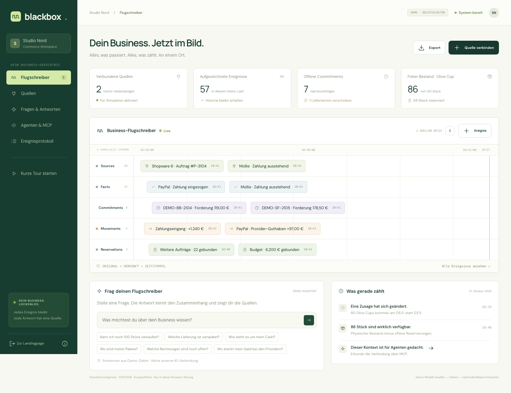

# Visual reference catalogue

The unchanged prototype is documented in **67 new screenshots: 58 desktop and 9 mobile captures**. All six top-level views are included: landing page, recorder, sources, questions/answers, agents/MCP and journal. Dialogs, meaningful lifecycle states and the 24 expanded Order-to-Cash questions supplement these pages.

These are synthetic design references, not evidence that authentication, connectors, persistence, MCP or the production product work. All engineering instructions are English. The original UI in these images is German; implement the production UI and landing page in **English by default and German**, as required by the build brief.

## Start with the complete user journey

1. [Landing page](desktop/01-landing.png) → [demo workspace](desktop/03-signup.png) → [source selection](desktop/05-onboarding-1.png) → [context explanation](desktop/06-onboarding-2.png) → [agent introduction](desktop/07-onboarding-3.png).
2. [Recorder](desktop/08-recorder.png) → [source catalogue](desktop/11-sources.png) → [business answer with evidence](desktop/22-answer-inventory.png) → [source detail](desktop/29-event-src-001.png).
3. [Agent/MCP page and question catalogue](desktop/46-agents.png) → the six expanded question groups below → [journal](desktop/56-journal.png).
4. Review the mobile captures before implementing responsive components. Open the [interactive prototype](../prototype/index.html) through the local preview server described in the repository README to inspect transitions and scrolling.

Read the screenshots together with the build brief, journal/MCP and performance specifications. Screenshots define visual intent; synthetic numbers, keyword-based answers and schematic MCP configuration do not define production behavior. The binding specifications take precedence over prototype shortcuts.

## Quick visual orientation

[](desktop/01-landing.png)

[](desktop/08-recorder.png)

## Capture coverage

**Full page** includes content below the fold. **Viewport** preserves the actual visible window; scrollable dialogs/drawers may continue below it. **Element** captures one complete source category or question section. Explicit history captures show the bottom of long invoice/payment drawers. Other provider dialogs reuse the same layouts and are represented by selected examples, not every possible provider/state combination.

### Landing and onboarding

| Screenshot | Framing | Pixels |
| --- | --- | --- |
| [01-landing: Complete landing page](desktop/01-landing.png) | full-page | 1440 × 2877 |
| [02-landing-hero: Landing page first viewport](desktop/02-landing-hero.png) | viewport | 1440 × 1000 |
| [03-signup: Create a demo workspace](desktop/03-signup.png) | viewport | 1440 × 1000 |
| [04-demo-information: Prototype capabilities and limitations](desktop/04-demo-information.png) | viewport | 1440 × 1000 |
| [05-onboarding-1: Choose demo sources](desktop/05-onboarding-1.png) | viewport | 1440 × 1000 |
| [06-onboarding-2: Understand the five-track context](desktop/06-onboarding-2.png) | viewport | 1440 × 1000 |
| [07-onboarding-3: Choose an agent and finish onboarding](desktop/07-onboarding-3.png) | viewport | 1440 × 1000 |

### Recorder

| Screenshot | Framing | Pixels |
| --- | --- | --- |
| [08-recorder: Recorder, five tracks, questions and recent activity](desktop/08-recorder.png) | full-page | 1440 × 1110 |
| [09-recorder-paused: Recorder with simulation paused](desktop/09-recorder-paused.png) | full-page | 1440 × 1110 |
| [10-recorder-new-event: Recorder after adding a simulated event](desktop/10-recorder-new-event.png) | full-page | 1440 × 1110 |

### Sources

| Screenshot | Framing | Pixels |
| --- | --- | --- |
| [11-sources: Complete source catalogue](desktop/11-sources.png) | full-page | 1440 × 3182 |
| [12-sources-shops: Shops and business sources](desktop/12-sources-shops.png) | element | 1154 × 670 |
| [13-sources-payment: Payment and payout sources](desktop/13-sources-payment.png) | element | 1154 × 829 |
| [14-sources-billing: Invoice and accounting sources](desktop/14-sources-billing.png) | element | 1154 × 844 |
| [15-sources-tracking: Shipping sources within the shared catalogue](desktop/15-sources-tracking.png) | element | 1154 × 360 |

### Source dialogs

| Screenshot | Framing | Pixels |
| --- | --- | --- |
| [16-connect-shopify: Manage an active Shopify demo source](desktop/16-connect-shopify.png) | viewport | 1440 × 1000 |
| [17-connect-api: Connect a custom API demo source](desktop/17-connect-api.png) | viewport | 1440 × 1000 |
| [18-connect-dhl: Connect a DHL demo source](desktop/18-connect-dhl.png) | viewport | 1440 × 1000 |
| [19-connect-easybill: Connect an easybill demo source](desktop/19-connect-easybill.png) | viewport | 1440 × 1000 |
| [20-connect-shopify_payments: Connect a Shopify Payments demo source](desktop/20-connect-shopify_payments.png) | viewport | 1440 × 1000 |

### Questions and evidence

| Screenshot | Framing | Pixels |
| --- | --- | --- |
| [21-answers-empty: Questions page before asking](desktop/21-answers-empty.png) | full-page | 1440 × 1000 |
| [22-answer-inventory: Available stock and reservations](desktop/22-answer-inventory.png) | full-page | 1440 × 1000 |
| [23-answer-delivery: Changed supplier delivery commitment](desktop/23-answer-delivery.png) | full-page | 1440 × 1000 |
| [24-answer-cash: Cash and committed expenses](desktop/24-answer-cash.png) | full-page | 1440 × 1000 |
| [25-answer-tracking: Shipment status and exceptions](desktop/25-answer-tracking.png) | full-page | 1440 × 1000 |
| [26-answer-billing: Outstanding invoice amounts](desktop/26-answer-billing.png) | full-page | 1440 × 1000 |
| [27-answer-payments: Money held by payment providers](desktop/27-answer-payments.png) | full-page | 1440 × 1000 |
| [28-answer-unknown: Insufficient data response](desktop/28-answer-unknown.png) | full-page | 1440 × 1000 |

### Event details: all five tracks

| Screenshot | Framing | Pixels |
| --- | --- | --- |
| [29-event-src-001: Source event and original evidence](desktop/29-event-src-001.png) | viewport | 1440 × 1000 |
| [30-event-fac-001: Extracted fact and linked evidence](desktop/30-event-fac-001.png) | viewport | 1440 × 1000 |
| [31-event-com-002: Current commitment and prior history](desktop/31-event-com-002.png) | viewport | 1440 × 1000 |
| [32-event-mov-001: Movement and evidence](desktop/32-event-mov-001.png) | viewport | 1440 × 1000 |
| [33-event-res-001: Reservation and linked order](desktop/33-event-res-001.png) | viewport | 1440 × 1000 |
| [34-event-com-001: Superseded commitment retained in the journal](desktop/34-event-com-001.png) | viewport | 1440 × 1000 |

### Invoice lifecycle

| Screenshot | Framing | Pixels |
| --- | --- | --- |
| [35-invoice-issued: Original invoice and receivable](desktop/35-invoice-issued.png) | viewport | 1440 × 1000 |
| [36-invoice-corrected: Invoice after a partial correction](desktop/36-invoice-corrected.png) | viewport | 1440 × 1000 |
| [37-invoice-cancelled: Remaining receivable cancelled without a cash refund](desktop/37-invoice-cancelled.png) | viewport | 1440 × 1000 |
| [38-invoice-history: Invoice drawer scrolled to historical evidence](desktop/38-invoice-history.png) | viewport | 1440 × 1000 |

### Payment lifecycle

| Screenshot | Framing | Pixels |
| --- | --- | --- |
| [39-payment-authorized: Authorization before capture](desktop/39-payment-authorized.png) | viewport | 1440 × 1000 |
| [40-payment-in-transit: Payout sent, bank receipt still unconfirmed](desktop/40-payment-in-transit.png) | viewport | 1440 × 1000 |
| [41-payment-bank-matched: Payout matched to a separate synthetic bank record](desktop/41-payment-bank-matched.png) | viewport | 1440 × 1000 |
| [42-payment-history: Payment drawer scrolled to earlier evidence](desktop/42-payment-history.png) | viewport | 1440 × 1000 |
| [43-payment-disputed: PayPal dispute and held balance](desktop/43-payment-disputed.png) | viewport | 1440 × 1000 |
| [44-refund-pending: Mollie refund reserved but not completed](desktop/44-refund-pending.png) | viewport | 1440 × 1000 |
| [45-refund-completed: Mollie refund completed and reservation released](desktop/45-refund-completed.png) | viewport | 1440 × 1000 |

### Agents and MCP

| Screenshot | Framing | Pixels |
| --- | --- | --- |
| [46-agents: MCP concept, tools and all 24 Order-to-Cash questions](desktop/46-agents.png) | full-page | 1440 × 3377 |
| [47-agent-chatgpt: ChatGPT connection concept](desktop/47-agent-chatgpt.png) | viewport | 1440 × 1000 |
| [48-agent-custom: Custom agent connection concept](desktop/48-agent-custom.png) | viewport | 1440 × 1000 |
| [49-agent-simulation: Simulated agent answer with evidence](desktop/49-agent-simulation.png) | viewport | 1440 × 1000 |

### Order-to-Cash question groups

| Screenshot | Framing | Pixels |
| --- | --- | --- |
| [50-otc-order: All four expanded questions: Order and availability](desktop/50-otc-order.png) | element | 1154 × 2052 |
| [51-otc-delivery: All four expanded questions: Delivery and customer communication](desktop/51-otc-delivery.png) | element | 1154 × 2052 |
| [52-otc-invoice: All four expanded questions: Invoices and receivables](desktop/52-otc-invoice.png) | element | 1154 × 2052 |
| [53-otc-collection: All four expanded questions: Customer payments and clarification](desktop/53-otc-collection.png) | element | 1154 × 2063 |
| [54-otc-settlement: All four expanded questions: Payouts and bank reconciliation](desktop/54-otc-settlement.png) | element | 1154 × 2062 |
| [55-otc-reversal: All four expanded questions: Cancellations, returns and refunds](desktop/55-otc-reversal.png) | element | 1154 × 2093 |

### Journal

| Screenshot | Framing | Pixels |
| --- | --- | --- |
| [56-journal: Complete seeded event journal](desktop/56-journal.png) | full-page | 1440 × 3147 |
| [57-journal-filtered: Commitment history: current and superseded promise](desktop/57-journal-filtered.png) | full-page | 1440 × 1000 |
| [58-journal-empty: Journal with no matching events](desktop/58-journal-empty.png) | full-page | 1440 × 1000 |

### Mobile

| Screenshot | Framing | Pixels |
| --- | --- | --- |
| [01-landing-page: Mobile landing page](mobile/01-landing-page.png) | full-page | 390 × 3704 |
| [02-recorder: Mobile recorder](mobile/02-recorder.png) | full-page | 390 × 1606 |
| [03-source-catalogue: Mobile source catalogue](mobile/03-source-catalogue.png) | full-page | 390 × 6476 |
| [04-answer-with-evidence: Mobile answer with evidence](mobile/04-answer-with-evidence.png) | full-page | 390 × 1123 |
| [05-agents-and-order-to-cash-examples: Mobile agents and Order-to-Cash examples](mobile/05-agents-and-order-to-cash-examples.png) | full-page | 390 × 6403 |
| [06-journal-and-horizontal-table-layout: Mobile journal and horizontal table layout](mobile/06-journal-and-horizontal-table-layout.png) | viewport | 390 × 844 |
| [07-navigation-open: Mobile navigation open](mobile/07-navigation-open.png) | viewport | 390 × 844 |
| [08-demo-workspace-dialog: Mobile demo workspace dialog](mobile/08-demo-workspace-dialog.png) | viewport | 390 × 844 |
| [09-source-evidence-drawer: Mobile source evidence drawer](mobile/09-source-evidence-drawer.png) | viewport | 390 × 844 |

## Coverage boundaries and missing product views

- **Represented:** all implemented top-level routes, the three onboarding steps, all five event types, an explicitly superseded commitment, each source category, six prepared answer types and an unknown-data answer, invoice corrections/cancellation, payment authorization/payout/bank evidence/dispute/refund states, all three agent choices, simulated MCP answer, all 24 expanded question explanations, journal filtering and empty results, and representative mobile layouts.
- **Still to design and implement:** real sign-in/recovery/account verification, workspace switching and invitations, roles/permission administration, real provider authorization and credential rotation, sync health/import progress/retries/reconciliation, production MCP authorization/token management and client error states, operational settings/backup/restore/upgrade screens, and complete English product copy. Follow the build brief for mandatory scope; a missing reference screen does not remove a requirement or automatically add a new UI requirement.
- **Prototype limitations to improve:** the recorder and journal use horizontally scrollable content on small screens; long evidence drawers scroll independently. Fixed navigation appears only within the initial viewport of full-page browser captures. Preserve the visual language while making the production layout usable and accessible.
- **Not exhaustive:** this catalogue does not enumerate every combination of source selection, event, payment step, filter, open question, validation message, browser or screen size. The local prototype and capture recipes provide the remaining interaction context.
- **Live integrations:** provider cards and demo activation controls are concepts. A visible provider card is not an implemented connector. Shipping remains an ordinary source category; Xentral is not part of this reference.

## Provenance and reproduction

The [capture manifest](capture-manifest.json) lists each file, SHA-256 checksum, dimensions, viewport, route and ordered interaction recipe. The [reference manifest](../manifest.json) identifies the unchanged source snapshot. Captures use fresh browser contexts, the original synthetic data, device scale factor 1, desktop 1440 × 1000 and mobile 390 × 844. The automatic demo clock is held at its initial state; explicitly clicked simulation controls still advance their demo lifecycles. Animations/caret/transient toast are suppressed and scrolling is instant for stable images. No business text, data or layouts were rewritten for the images.

With Node.js and Playwright available as local tooling:

```sh
node reference/capture-screenshots.cjs
```

The script uses the local static files and a headless Chromium browser. Install the matching Chromium runtime if Playwright does not have one. Google Fonts needs network access when not cached. For tooling installed in a separate directory, set `BLACKBOX_CAPTURE_MODULE_ROOT` to its `node_modules` directory. Optional `BLACKBOX_CAPTURE_FILTER=desktop/57-` recaptures just matching cases and retains existing manifest entries. A full run is the authoritative way to refresh the entire catalogue. This is a capture utility, not the production UI test runner or a pixel-perfect regression oracle.

After an intentional refresh, review the images and regenerate the repository reference baseline checksums. Do not edit screenshots to imply missing functionality works.

## Earlier highlights

The initial preparation included two highlights of the most recently edited areas. They are retained for provenance and are superseded for coverage by the catalogue above:

- [Earlier sources highlight](blackbox-sources-without-xentral.jpg)
- [Earlier Order-to-Cash agents highlight](blackbox-order-to-cash-agents.jpg)
